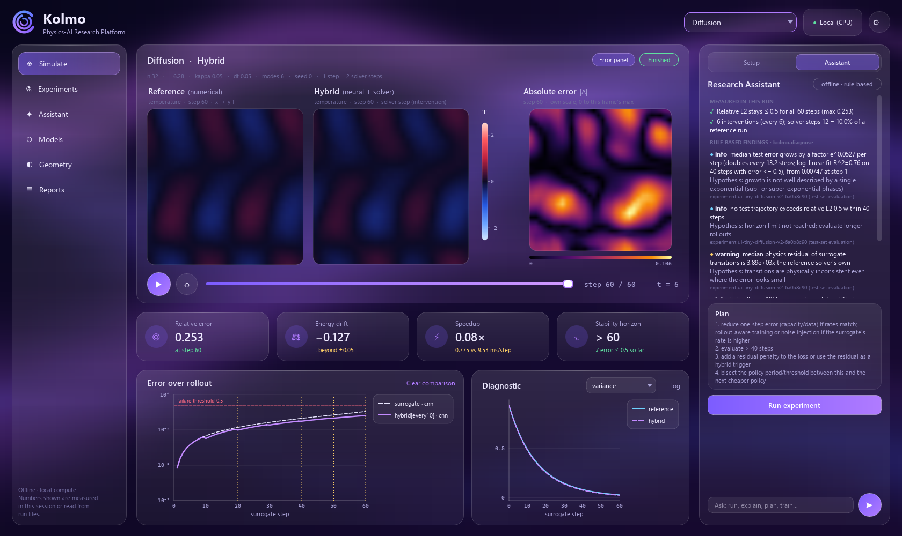

# Kolmo

**Neural world models for physics, kept honest by a numerical solver.**

Kolmo takes a photo of an object and segments it with Meta's **SAM 3.1**, then simulates the flow around it with an
exact numerical solver. It trains neural surrogates (CNN, FNO and a **JEPA-style latent world model**) to predict that
flow far faster, and measures exactly when and why those predictions stop being trustworthy. A hybrid mode lets the
solver step in. A research assistant (a Meta model on Groq, offline by default) turns questions into experiments and
explains *measured* results. Everything runs on a laptop CPU.



## The question

Learned surrogates are fast, but they are autoregressive: errors compound step after step until the prediction is
noise or blows up. Kolmo makes that failure **measurable**: error vs horizon, time-to-failure, energy drift, physics
residual and spectra. It then tests fixes one at a time against the same held-out scenarios:

| Fix | Idea | Status |
|---|---|---|
| Rollout-aware training | train on several consecutive predicted steps | measured |
| Fourier neural operator | global spectral layers instead of local convolutions | measured |
| JEPA-style latent world model | predict the future in a learned latent space (I-JEPA objective, VICReg anti-collapse) | measured |
| Hybrid execution | re-anchor on the solver every *k* steps, or when the physics residual / energy drift trips | measured; trade-off study in progress |

## Results so far

2D Kolmogorov flow, 64 × 64, viscosity 0.002–0.003 for training and 0.005 held out. 8 held-out initial conditions,
200 steps; one surrogate step is 10 solver steps. A rollout "fails" when its relative L2 error exceeds 0.5. A perfect
model starting from the same first-step error would cross that threshold around step 50, because the flow is chaotic.

| Model | Error at step 1 | Error at step 10 | Steps to failure | Blew up? |
|---|---|---|---|---|
| CNN, one-step training | 0.193 | 0.858 | 4 | yes (689 non-physical states) |
| CNN, rollout-aware (K = 4) | 0.208 | 0.791 | 5 | no |
| JEPA latent world model | — | 0.515 | 10 (13 on unseen viscosity) | after ~4 trained steps in pure latent mode |
| **FNO, one-step** | **0.149** | **0.376** | **15** | no |

**What this says, honestly:**
- Rollout-aware training removes the blow-up but does not extend the useful horizon.
- Predicting in latent space (JEPA) roughly doubles time-to-failure over pixel-space CNNs, but a pure latent rollout
  leaves the encoder's manifold. Re-encoding every step keeps it bounded at the cost of the gain.
- The FNO is the strongest model.
- Hybrid re-anchoring stops blow-ups, but it cannot undo drift that has already happened.

Full tables and definitions: [docs/evaluation.md](docs/evaluation.md),
[docs/latent-world-model.md](docs/latent-world-model.md).

## Meta models inside

| Model | Used for | Where it runs |
|---|---|---|
| **SAM 3.1** (Segment Anything 3.1) | photo → object mask → obstacle in the flow | locally on CPU, no API calls ([docs/geometry.md](docs/geometry.md)) |
| **JEPA** (Joint-Embedding Predictive Architecture, the I-JEPA objective) | architecture of the latent world model, trained on our own simulations | locally, JAX ([docs/latent-world-model.md](docs/latent-world-model.md)) |
| **Muse Spark** (`meta-models/muse-spark-open` on Groq) | research assistant: question → validated experiment → explanation of measured numbers | Groq API, only when you enable it ([docs/assistant.md](docs/assistant.md)) |
| SAM 3D Objects | photo → 3D shape (study on making it run on light hardware) | in progress ([docs/sam3d-lightweight.md](docs/sam3d-lightweight.md)) |

## Run it

Requirements: Python 3.10+, JAX (CPU), Flax, Optax, NumPy, Matplotlib, OpenCV, and PySide6-Essentials 6.7. Use 6.7
specifically with Anaconda: newer builds need a newer MSVC runtime.

The desktop app:
```bash
python -m kolmo
```

Reproduce the long-horizon experiment (writes `runs/<name>-<hash>/` with config, results.json, plots and report.md):
```bash
python -m kolmo.experiments run benchmarks/long_horizon.json
```

Turn a photo into an obstacle (falls back to OpenCV GrabCut without SAM weights):
```bash
python -m kolmo.geometry photo.jpg --prompt "car" --n 128
```

Run the tests:
```bash
python -m pytest tests -q
```

The assistant works offline. To use the hosted model, copy `.env.example` to `.env`, then set `GROQ_API_KEY` and
`KOLMO_LLM_LIVE=1`.

## How it is built

```
kolmo/core.py              contracts: System, Trajectory (a new physics domain only implements System)
kolmo/systems/fluid2d.py   2D incompressible Navier-Stokes, pseudo-spectral, IF-RK3, 2/3 dealiasing, Brinkman obstacles
kolmo/systems/diffusion.py heat diffusion, exact in time (second domain, validates the interfaces)
kolmo/surrogates/          data generation, CNN / FNO / JEPA latent models, one-step and rollout-aware training
kolmo/rollout.py           autoregressive rollout with failure detection, compile time vs steady-state time
kolmo/hybrid.py            reference / surrogate / hybrid execution; every solver intervention logged with its reason
kolmo/evaluate.py          error vs horizon, time-to-failure, residual, drift, spectra, runtime, generalisation
kolmo/diagnose.py          rule-based findings from measured results (facts vs interpretation kept apart)
kolmo/experiments.py       reproducible runs: config, seeds, environment, results, report
kolmo/geometry/            photo → SAM 3.1 / GrabCut mask → grid obstacle
kolmo/assistant/           provider interface, tools over real code, number checking
kolmo/app/                 PySide6 desktop UI
```

Solver verification ([docs/physics.md](docs/physics.md)): 8 tests pass.

| Test | Result |
|---|---|
| Taylor-Green decay | relative error 9.7e-6 |
| Kolmogorov laminar steady state | 7.4e-6 |
| Energy budget | 1.6e-4 |
| Temporal order | 3.06 (RK3) |
| Determinism | bit-identical |
| Penalised cylinder | drag converges with the mask size |

## Honesty rules

- **No fabricated numbers.** Every number in the app, the reports and this README comes from a run in `runs/`.
  Pending results are labelled pending.
- **Physics residual ≠ prediction error.** Without a reference, Kolmo reports risk indicators, not the error.
- **The assistant explains, it does not measure.** Numbers in its answers are checked against tool outputs; unknown
  numbers are replaced by `[unverified]`.

## Licences of third-party models

SAM 3.1 / SAM 3D are used under Meta's SAM License: a copy is kept next to downloaded weights, and use is
acknowledged here. Muse Spark is used through Groq under Groq's and Meta's terms. Weights are not redistributed in
this repository.
