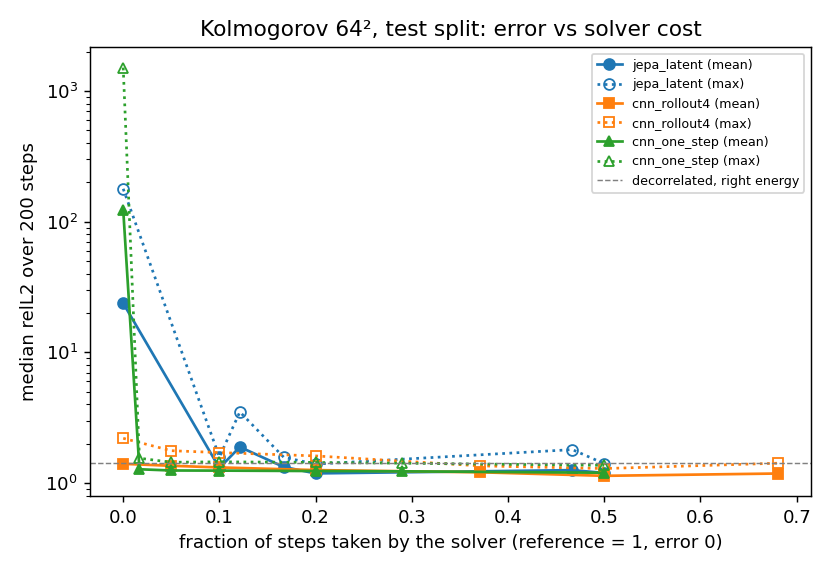

# JEPA-style latent world model (kolmo/surrogates/latent.py)

Question: does predicting the future in a learned latent space (JEPA) make long-horizon rollouts of 2D Kolmogorov
flow more reliable than pixel-space CNN surrogates? Short answer: it roughly doubles time-to-failure, but a pure
latent rollout still diverges beyond the trained horizon; it does not fix long-horizon reliability.

## Method

- Encoder E: 4x4 patch conv (64x64 -> 16x16 latent, D = 24 channels), GELU, periodic 3x3 conv.
- Predictor P: residual 3-conv periodic CNN on the latent grid, input = latent + nu plane + 4 position harmonics
  (same conditioning as the baseline), zero-init last layer. Rolled out K = 4 steps in latent space during training.
- Decoder G: periodic 3x3 conv, GELU, 1x1 conv, pixel shuffle back to 64x64.
- Loss: JEPA latent prediction against an EMA target encoder (rate 0.99, stop-grad) [Assran et al. 2023, I-JEPA];
  VICReg variance hinge + covariance penalty on encoder outputs against collapse, weights 1 : 0.04 (VICReg 25:25:1)
  [Bardes, Ponce, LeCun 2022, VICReg, ICLR]; small autoencoding term (0.1); decoder also fitted on stop-grad
  predicted latents so rollouts can be decoded. Exact formula: module docstring.
- Rollout: `LatentSurrogate.stepper` carries the latent between calls and only decodes for output (mode `latent`);
  mode `reencode` re-encodes every decoded state (a pixel loop through the same network).
- Ablation `pixel_ablation`: identical network, `w_jepa=0, pixel_grad=True` (trained by decoded-rollout pixel loss,
  K = 4), i.e. latent dynamics without the JEPA objective.
- Parameters: 30,520 (baseline CNN width 32 depth 4 pos 4: ~33.2k).

Checkpoint: exactly `train.save` format (`<path>.npz` + `.json`, arch kind `latent`). Importing
`kolmo.surrogates.latent` registers the kind in `models.ARCHS`; then `train.load` returns a plain `Surrogate`
(re-encode mode) usable by rollout/evaluate/hybrid/UI, and `latent.load` returns the latent-rollout `LatentSurrogate`.
Adapter needed for the UI/experiments: they only see `latent` after that import (one line, e.g. a lazy import in
`models.build` for kind `latent`; not added, the file belongs to the baseline work).

## Setup

Dataset and split identical to `benchmarks/long_horizon.json` (cache `data-fluid2d-0b797a16931d`): n = 64, nu in
{0.002, 0.003} train/test, held-out nu = 0.005, 1 surrogate step = 10 solver steps (dt 0.006), 200 steps evaluated,
8 test / 4 held-out trajectories, failure threshold relL2 > 0.5. Training: 2000 steps, batch 8, lr 1e-3, early
stopping on 20-step validation rollout (same as baseline). Baselines: `runs/kolmogorov64_long_horizon-88294366`.

    python -m kolmo.surrogates.latent benchmarks/long_horizon.json runs/latent_kolmogorov64/jepa
    python -m kolmo.surrogates.latent benchmarks/long_horizon.json runs/latent_kolmogorov64/pixel_ablation w_jepa=0 pixel_grad=true
    python -m pytest tests/test_latent.py -q

## Results (median over trajectories; test = held-out seeds)

| model | split | relL2@1 | @10 | @50 | @200 | TTF median (min) | energy drift final | nonphysical steps |
|---|---|---|---|---|---|---|---|---|
| cnn_one_step | test | 0.193 | 0.858 | 1.21 | 1506 | 4 (3) | 2.7e6 | 689 |
| cnn_rollout4 | test | 0.208 | 0.791 | 1.17 | 2.20 | 5 (3) | 2.75 | 0 |
| JEPA latent rollout | test | 0.276 | **0.515** | 1.91 | 178 | **10 (6)** | 3.2e4 | 610 |
| JEPA re-encode | test | 0.276 | 0.800 | 1.28 | 1.47 | 5 (4) | 0.044 | 0 |
| pixel-loss latent (ablation) | test | 0.247 | 0.610 | 6.27 | 1.3e11 | 9 (7) | 1.7e22 | 1153 |
| cnn_one_step | heldout | 0.153 | 0.802 | 1.25 | 1061 | 4.5 (4) | 1.2e6 | 332 |
| cnn_rollout4 | heldout | 0.177 | 0.783 | 1.58 | 6.23 | 4.5 (4) | 37.9 | 0 |
| JEPA latent rollout | heldout | 0.197 | **0.426** | 1.96 | 99 | **13 (13)** | 9.9e3 | 313 |
| JEPA re-encode | heldout | 0.197 | 0.747 | 1.37 | 1.31 | 6.5 (5) | -0.16 | 0 |
| pixel-loss latent (ablation) | heldout | 0.174 | 0.579 | 8.0 | 6.2e10 | 9.5 (9) | 7.8e21 | 586 |

Chaos floor (`first_step_only`, test) at step 10: 0.22-0.23 for every model, so all are well above it. Trivial
references on the test split: per-pixel climatology relL2 ~0.96-0.98; persistence 0.94 at step 10, 1.39 at 200;
a decorrelated state with the right energy sits at ~1.41. Residual metric: unavailable for this benchmark (the
solver refuses dt = 10 x 0.006 by CFL), same for the baselines. Runtime speedups (22x latent vs 1.4x CNN) were
measured on a shared, differently loaded CPU and are not comparable.

## Conclusion

- Short horizon: carrying the state in latent space doubles time-to-failure (10-13 vs 4-5 steps) and lowers
  relL2@10 from ~0.8 to 0.43-0.52, including at held-out viscosity. The ablation gets most of that (9-9.5 steps), so
  the gain comes mainly from latent-space rollout (16x16 grid, large receptive field), with JEPA adding a modest
  improvement (0.515 vs 0.610 test, 0.426 vs 0.579 held-out at step 10).
- Long horizon: the pure latent rollout is not reliable. Trained on K = 4, the latent drifts off the encoder's
  manifold and the decoded state blows up (energy x1e4 by step 200). JEPA is about 9 orders of magnitude more contained
  than the pixel-loss ablation, but still worse than cnn_rollout4 (relL2@200 2.2, no nonphysical steps).
- Re-encoding every step projects back onto the manifold: bounded and energy-consistent (|drift| <= 0.43, 0 nonphysical
  steps, relL2 ~1.3-1.5 = decorrelated, right energy), but TTF falls back to the CNN level (5-6.5).
- Net: JEPA is not a fix for long-horizon reliability here. The useful pattern is a hybrid: latent rollout for
  ~10 steps, then re-encode or re-anchor with the solver.

## Limits

One training seed per model, 8 + 4 evaluation trajectories, 2000 steps (about 5 min on a shared 2-core CPU), and no
tuning of the EMA rate, VICReg weights, latent size or K. Not tried: longer latent unrolls (K > 4) or periodic
re-encoding inside the latent rollout, which are the obvious next tests. TTF is censored at 200 steps.
Hybrid policies were not evaluated on Fluid2D (they work in the test).

## Hybrid study: error vs solver cost

`PYTHONPATH=. python benchmarks/latent_hybrid_study.py` (results: `runs/latent_hybrid_study/results.json`, plot
`runs/latent_hybrid_study/pareto.png` = `docs/images/pareto.png`). Same 8 test trajectories, 200 steps (12 time units).
Policies are `kolmo.hybrid`: `every k` = one solver step (10 solver substeps) every k surrogate steps, taken from the
current hybrid state (it is not reset to the true trajectory); for the latent model the next step re-encodes that
solver state. `E>0.2` = energy-drift trigger. `res>0.5` = residual trigger. The 10-step reference residual is ~0.06 here
(0.05-0.07), and surrogate proposals sit at 0.43-0.55, so 0.05 rejected every proposal (cost 1.0); 0.5 is the
informative setting. Errors: median over trajectories of relL2(t), then the max / mean over t = 1..200. Wall time:
trajectory 0, compile excluded, reference and all policies interleaved, 3 repeats, median. Reference: 0.130 s per
time unit (repeats 1.67 / 1.50 / 1.56 s).

| model | policy | max relL2 | mean relL2 | solver fraction | nonphysical steps | s per time unit | speedup |
|---|---|---|---|---|---|---|---|
| jepa_latent | surrogate | 178 | 23.7 | 0 | 610 | 0.0083 | 15.6 |
| jepa_latent | every 20 | 3.50 | 1.89 | 0.121* | 162 | 0.031 | 4.2 |
| jepa_latent | every 10 | 1.58 | 1.30 | 0.10 | 0 | 0.023 | **5.7** |
| jepa_latent | every 5 | 1.39 | 1.18 | 0.20 | 0 | 0.036 | 3.6 |
| jepa_latent | every 2 | 1.41 | 1.19 | 0.50 | 0 | 0.074 | 1.75 |
| jepa_latent | E>0.2 | 1.57 | 1.33 | 0.167 | 0 | 0.056 | 2.3 |
| jepa_latent | res>0.5 | 1.80 | 1.25 | 0.467 | 0 | 0.526 | 0.25 |
| cnn_rollout4 | surrogate | 2.20 | 1.40 | 0 | 0 | 0.103 | 1.26 |
| cnn_rollout4 | every 20 | 1.77 | 1.35 | 0.05 | 0 | 0.096 | 1.35 |
| cnn_rollout4 | every 10 | 1.71 | 1.31 | 0.10 | 0 | 0.101 | 1.28 |
| cnn_rollout4 | every 5 | 1.61 | 1.25 | 0.20 | 0 | 0.094 | 1.38 |
| cnn_rollout4 | every 2 | 1.29 | 1.13 | 0.50 | 0 | 0.108 | 1.20 |
| cnn_rollout4 | E>0.2 | 1.42 | 1.18 | 0.681 | 0 | 0.132 | 0.99 |
| cnn_rollout4 | res>0.5 | 1.35 | 1.21 | 0.371 | 0 | 0.496 | 0.26 |
| cnn_one_step | surrogate | 1506 | 123 | 0 | 689 | 0.081 | 1.61 |
| cnn_one_step | every 20 | 1.44 | 1.25 | 0.05 | 0 | 0.087 | 1.48 |
| cnn_one_step | every 10 | 1.45 | 1.24 | 0.10 | 0 | 0.103 | 1.26 |
| cnn_one_step | every 5 | 1.44 | 1.23 | 0.20 | 0 | 0.093 | 1.39 |
| cnn_one_step | every 2 | 1.36 | 1.20 | 0.50 | 0 | 0.113 | 1.14 |
| cnn_one_step | E>0.2 | 1.42 | 1.23 | 0.29 | 0 | 0.126 | 1.03 |
| cnn_one_step | res>0.5 | 1.55 | 1.27 | 0.017 | 0 | 0.459 | 0.28 |

\* above 0.05 because non-finite latent proposals trigger extra solver steps.

Findings:
- No policy improves accuracy over 200 steps. Every hybrid lands at a mean relL2 of 1.13-1.35, against ~1.41 for a
  decorrelated state with the right energy and ~0.97 for climatology. The solver advances the hybrid state rather than
  the truth, so once the flow decorrelates (~5-10 steps) the error is set by chaos, not by the surrogate. Hybrids buy
  boundedness: non-physical steps drop to 0 for every model at k <= 10.
- The trade-off is in cost, not error. CNN steps cost about as much as the 10 solver substeps they replace on this CPU
  (pure CNN only 1.3-1.6x). JEPA latent + re-anchor every 10 is bounded, energy-consistent and 5.7x faster than the
  reference at the same error as any CNN hybrid. That is the Pareto point.
- Re-anchoring needs k <= 10 for the latent model (k = 20 still blows up, consistent with failure at ~10 steps).
- The residual trigger is the most expensive policy here (0.25-0.28x reference speed), because evaluating the residual
  costs more than the step it guards. It is also badly separated: CNN one-step proposals pass it 98% of the time, and
  it does not beat fixed re-anchoring.
- To get accuracy, not just boundedness, re-anchoring must use observed or true states (data assimilation). This
  kolmo.hybrid mode does not do that.
